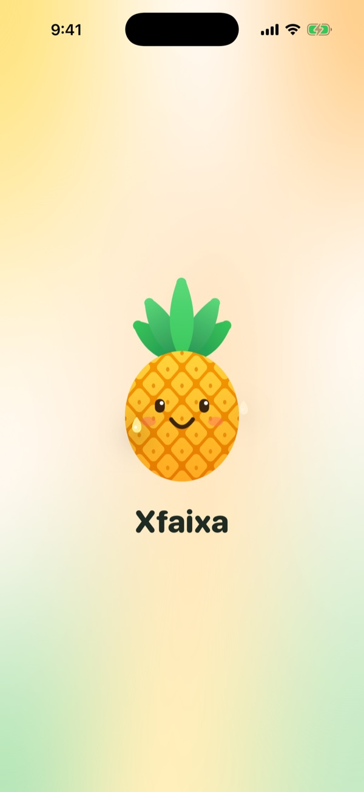
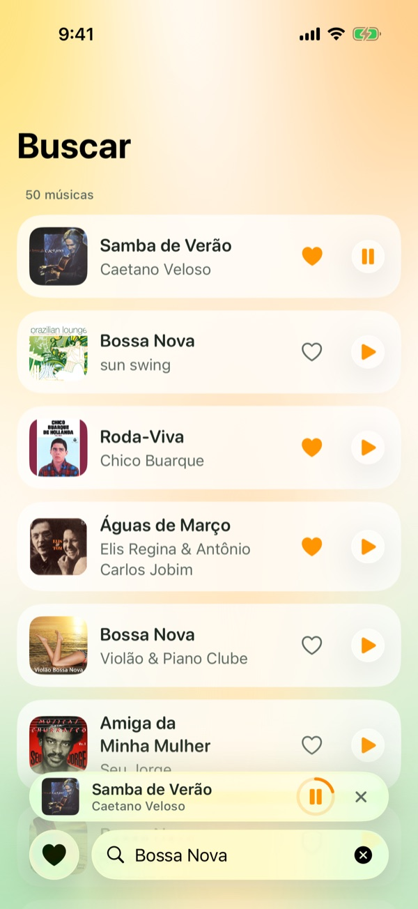
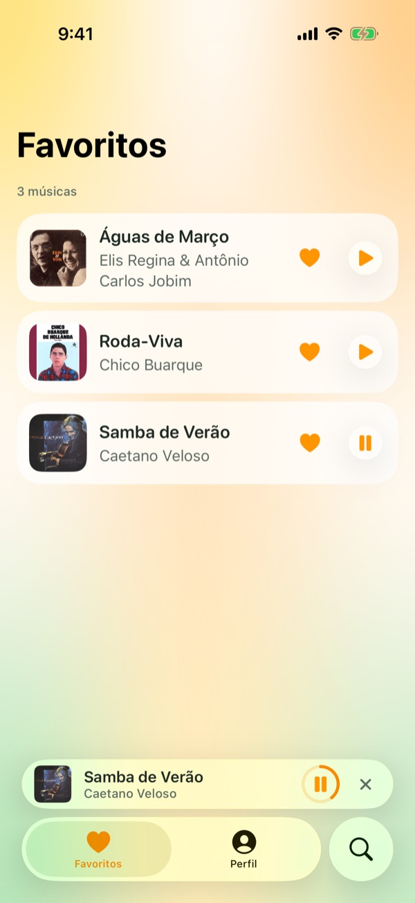
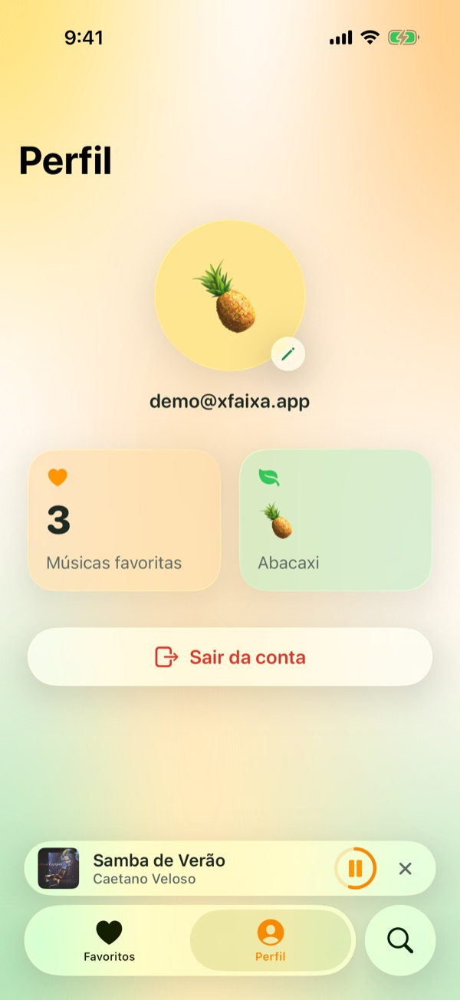
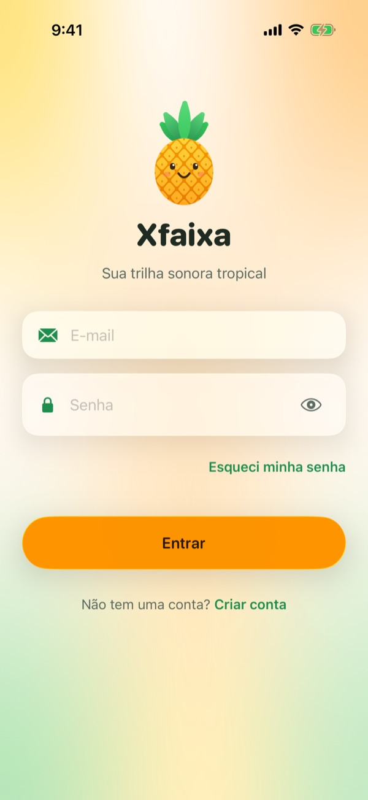
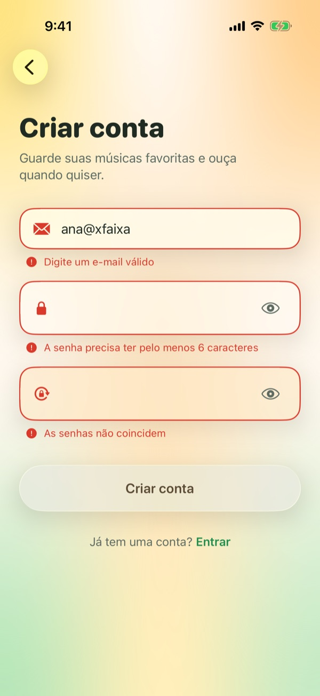
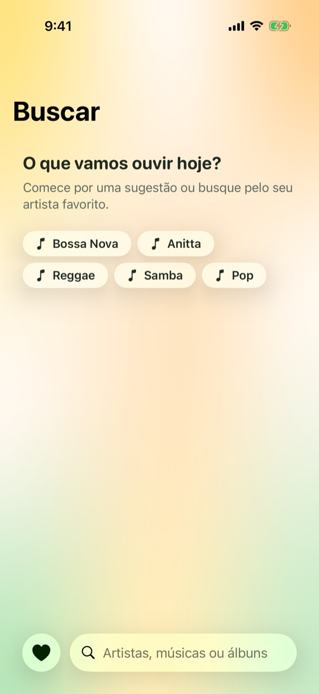
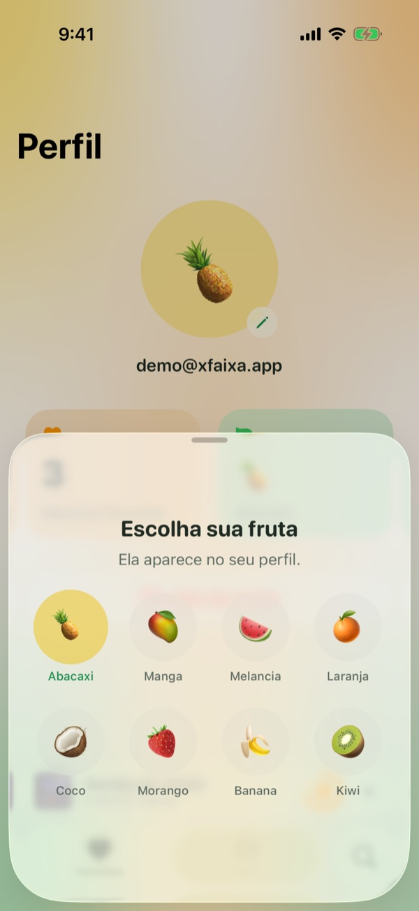
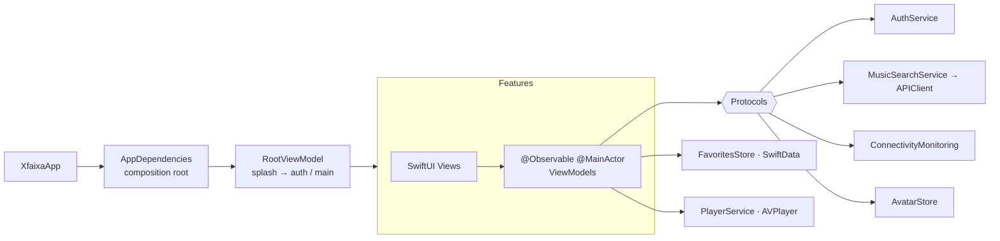

# Xfaixa 🍍

A tropical music finder for iOS 26, built natively with SwiftUI and Liquid Glass.
Search the iTunes catalog, play 30-second previews and keep your favorite songs, even offline.


<p align="center">
  
  
  
  
</p>

## Features

- **Search** songs in the iTunes catalog as you type, with suggestions, loading skeletons, and empty and error states.
- **Previews:** play 30-second previews from a floating Liquid Glass mini player that shows progress.
- **Favorites** stored per user with SwiftData. Artwork is cached locally, so the list works with no connection.
- **Account flow:** sign in, sign up with live validation, and password recovery.
- **Profile** with a fruit avatar picker, favorites count and sign out.
- **Offline awareness:** a global "Sem conexão" banner, instant offline errors, and automatic retry when the connection returns.
- **Accessibility:** Dynamic Type up to the largest accessibility sizes, VoiceOver labels and announcements, Reduce Motion, and 44 pt hit areas.

## Screens

| Splash | Login | Sign up | Password reset |
|:-:|:-:|:-:|:-:|
|  |  |  |  |

| Search | Results + mini player | Favorites | Profile | Fruit picker |
|:-:|:-:|:-:|:-:|:-:|
|  |  |  |  |  |

The interface is in Brazilian Portuguese. Code, comments and documentation are in English.

## Tech Stack

| Area | Choice |
|---|---|
| UI | SwiftUI, Liquid Glass (`glassEffect`, `GlassEffectContainer`, `glassEffectID`, `.glass` / `.glassProminent`) |
| State | Observation (`@Observable`), MVVM with `@MainActor` view models |
| Accounts | Firebase Authentication (email and password) |
| Concurrency | Swift 6 language mode, async/await, typed throws, `@concurrent` |
| Networking | `URLSession` with a generic, protocol-based API client |
| Persistence | SwiftData for favorites, `UserDefaults` for the avatar choice |
| Audio | AVFoundation (`AVPlayer`) |
| Connectivity | Network framework (`NWPathMonitor`) |
| Tests | Swift Testing for unit tests, XCTest for UI tests and accessibility audits |

Apple frameworks only, plus FirebaseAuth for accounts (see [Authentication](#authentication)).

## Architecture

MVVM organized by feature. Views stay declarative, view models own the logic, and every service sits behind a protocol so it can be replaced in tests and previews.



```
Xfaixa/
├── App/                 Entry point, composition root, root routing and tab shell
├── DesignSystem/
│   ├── Tokens/          Typography, spacing, radii and sizes
│   └── Components/      GlassCard, PrimaryButton, GlassTextField, SongRow, chips, mascot…
├── Core/
│   ├── Networking/      Endpoint, APIClient, NetworkError, iTunes DTOs
│   ├── Auth/            AuthService protocol, AuthError, validation, in-memory service
│   ├── Persistence/     ModelContainer factory, FavoritesStore, AvatarStore
│   └── Services/        Music search, network monitor, player
├── Features/
│   ├── Splash/  Auth/  Search/  Favorites/  Profile/  Player/
└── Models/              Song, AppUser, FavoriteSong (@Model), Fruit
```

`AppDependencies.live()` is the only place that chooses concrete implementations. Previews use `AppDependencies.preview()`, which provides in-memory services and real catalog sample data.

## Technical Decisions

**Liquid Glass with system APIs only.** No hand-made blur. Glass is reserved for the floating control layer: fields, buttons, chips, the banner and the mini player. Song rows are content and use a translucent surface, following the iOS 26 guidance of not stacking glass on glass. An animated `MeshGradient` gives the glass something alive to refract.

**Debounce and cancellation without Combine.** The search screen runs `.task(id: query)`. Each keystroke cancels the previous task, so a `Task.sleep(400 ms)` at the start acts as the debounce, and the cancellation reaches `URLSession` if the request is already in flight. A stale response can never overwrite a newer one.

**One view state per screen.** `SearchViewModel.State` (`idle`, `loading`, `loaded`, `empty`, `failed`) makes impossible combinations, such as loading with an error, impossible to represent.

**Typed errors end to end.** `APIClient` and `AuthService` use `throws(NetworkError)` and `throws(AuthError)`. Errors know their user-facing message, and auth errors know which form field they belong to.

**Off the main actor where it matters.** The project uses default `MainActor` isolation with approachable concurrency. `URLSessionAPIClient.send` is marked `@concurrent`, so requests and JSON decoding never run on the main actor, even when a `@MainActor` view model awaits them.

**DTOs separate from the domain.** `ITunesTrack` mirrors the API, with every field optional. `Song` is the model the app uses. Mapping discards incomplete results and requests 600 px artwork from the CDN, although the API only advertises 100 px.

**Offline by design.** `FavoriteSong` is a SwiftData `@Model` with `#Unique([userId, songId])` and an index on `userId` and `addedAt`. Each favorite stores everything needed to render it, including the artwork bytes, held in `.externalStorage`. If the store can't be opened, the app falls back to memory instead of crashing.

**One player, guaranteed.** A single `PlayerService` owns the only `AVPlayer`. Starting a song replaces the current item, so two previews can never overlap. The mini player lives in `.tabViewBottomAccessory`, the iOS 26 API behind Apple Music's bar, and collapses automatically when the tab bar minimizes on scroll.

**Connectivity as a dependency.** `NetworkMonitor` wraps `NWPathMonitor` behind `ConnectivityMonitoring`. Search fails fast when the path is down instead of waiting for a timeout, and it retries automatically when the connection comes back.

## Testing

```bash
xcodebuild test -project Xfaixa.xcodeproj -scheme Xfaixa \
  -destination 'platform=iOS Simulator,name=iPhone 17 Pro'
```

**Unit tests (Swift Testing):** 68 cases, using mocks for every service:

- `SearchViewModel`: results, empty and error states, ignored cancellation, query trimming, debounce cancellation, suggestions bypassing the debounce, offline fail-fast, reconnection retry.
- `AuthViewModel`: sign in and sign up validation, field and general errors, error clearing on edit, the password reset flow.
- `ProfileViewModel`: avatar persistence per user, live favorites count, sign out success and failure.
- `FavoritesStore`: add, remove and toggle, deduplication, ordering, persistence across instances, per-user scoping (in-memory SwiftData).
- Networking: DTO mapping, artwork upscaling, URL building and percent-encoding, `URLError` mapping.
- Firebase error mapping: every relevant Firebase error code translated to the app's `AuthError`.

**UI tests (XCTest):** the sign in flow, wrong-password errors and navigation to sign up. They launch the app with `-ui-testing`, which swaps Firebase for the in-memory backend, so they never depend on the network or on real accounts.

Accessibility was checked with `performAccessibilityAudit()` and at the largest Dynamic Type size. Song rows switch to a stacked layout at accessibility sizes, so titles are never truncated to a few letters.

## Getting Started

**Requirements:** Xcode 26 and an iOS 26.5 simulator or device.

1. Clone the repository and open `Xfaixa.xcodeproj`. Xcode resolves the Firebase package on the first build.
2. Choose an iPhone simulator and run (⌘R).

Without a Firebase configuration, the app runs on its built-in demo backend. Sign in with **demo@xfaixa.app** / **123456**. To use real accounts, follow the steps below.

## Authentication

Authentication is defined by the `AuthService` protocol, with two implementations:

- **`FirebaseAuthService`**: Firebase Authentication with email and password. It is the only file that imports Firebase. It translates Firebase error codes into `AuthError`, whose messages are in Portuguese. Firebase keeps the session in the keychain, so returning users skip the login screen.
- **`InMemoryAuthService`**: simulates latency and the same failure cases. It is used in previews, in UI tests, and as a fallback when there is no Firebase configuration.

`AppDependencies.live()` is the only place that chooses between them.

To configure Firebase:

1. In the [Firebase console](https://console.firebase.google.com), create a project and register an iOS app with the bundle ID `devpedrovillalba.Xfaixa`.
2. Under **Authentication → Sign-in method**, enable **Email/Password**.
3. Download `GoogleService-Info.plist` and add it to the `Xfaixa/` folder in Xcode, with the Xfaixa target checked. The file is listed in `.gitignore`, so every developer provides their own.
4. Build and run. The app detects the file and switches to Firebase automatically.

## Author

Pedro Villalba · [github.com/elprogramadorpedro](https://github.com/elprogramadorpedro)
